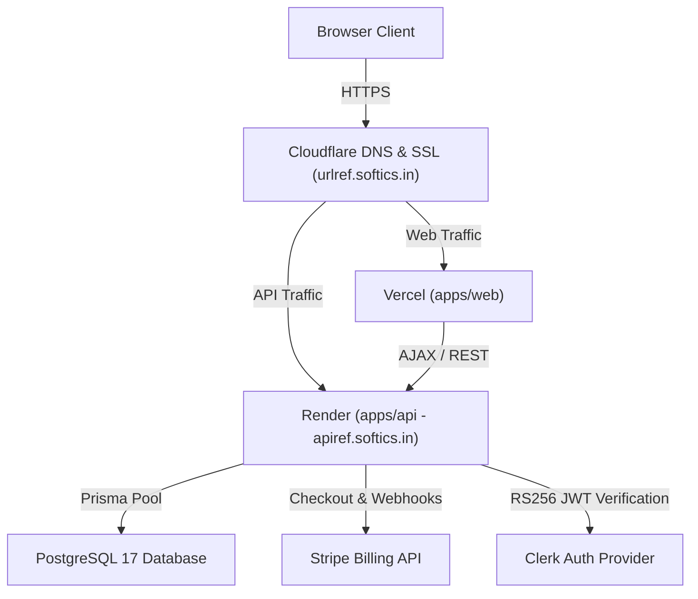

# URLRef Softics — High-Performance URL Shortener & Dynamic QR Studio

A production-grade, enterprise-ready link management platform and dynamic QR code studio built for high conversion, brand authority, and privacy-conscious analytics.

---

## Highlights & Features

- **Blazing Fast Base62 Redirect Engine:** Sub-10ms redirect lookups returning standard `HTTP 302 Found`, with non-blocking asynchronous click tracking via fire-and-forget background dispatches.
- **Dynamic QR Code Studio:** Multi-channel scannable QR generation supporting standard URLs, WhatsApp direct chat, UPI payment intents, Email, Telephone, SMS, and WiFi networks with real-time brand color customization and high-resolution center logo overlays.
- **Custom Branded Domains (BYOD):** Connect custom hostnames (e.g., `go.yourbrand.com`) with automated DNS verification (TXT challenge + CNAME routing), tier quota limits, and host-aware public redirects.
- **Stripe Subscriptions & Quota Enforcement:** Tiered subscription management (Free, Pro, Agency) powered by Stripe Checkout, Customer Portal, and HMAC webhook signature verification with automatic monthly link quota resets.
- **Dual Authentication Layer:** Seamless enterprise user onboarding with Clerk authentication (RS256 JWT validation) alongside high-security Argon2id password hashing and HTTP-only session cookies.
- **Privacy-Safe Link Analytics:** Aggregated metrics (click volume over time, device types, top referrer domains, ISO country codes) with zero raw IP or fingerprint storage.
- **Render Cold-Start Mitigation:** Automated, non-blocking `/health?warmup=true` background ping on frontend load with proactive PostgreSQL connection pool warming.
- **Non-Technical Error Boundary:** Reassuring, friendly error screens that preserve user trust, offer one-click page refresh or navigation to home, and tuck technical diagnostic details inside a collapsed drawer for support agents.

---

## Monorepo Architecture

```
urlref/
├── apps/
│   ├── api/                    # Node.js + Express 5 + Prisma API backend
│   │   ├── prisma/             # Schema definitions and database migrations
│   │   ├── src/
│   │   │   ├── config/         # Environment variable validation (Zod)
│   │   │   ├── database/       # Singleton PrismaClient connection pool
│   │   │   ├── middleware/     # Auth, CSRF, CORS, Rate-limit, Request ID, Logging
│   │   │   ├── modules/        # Health, Auth, Links, Redirects, Domains, Billing, Analytics
│   │   │   └── utils/          # Pino logger and client observability
│   │   └── test/               # Vitest integration test suite (Supertest)
│   │
│   └── web/                    # React 18 + Vite + Material UI frontend
│       ├── public/             # Brand favicon, robots.txt, sitemap.xml
│       └── src/
│           ├── components/     # Modals, Navbar, Sidebar, QR Studio, Quick Shortener
│           ├── context/        # Unified Auth context (Clerk + Session)
│           ├── pages/          # Landing, Dashboard, Links, QR, Domains, Analytics
│           ├── services/       # Axios API client, query keys, server health wake-up
│           └── theme/          # Custom soft olive & warm sunlight gold design system
│
├── packages/
│   ├── shared/                 # Shared Zod validation contracts and TypeScript DTOs
│   └── config/                 # Monorepo ESLint, Prettier, and TypeScript base configs
│
├── docs/                       # Architecture, PRD, security, database, and API specs
├── tests/                      # Playwright end-to-end browser tests
├── docker-compose.yml          # Containerized local PostgreSQL 17
├── render.yaml                 # Render infrastructure-as-code deployment blueprint
└── AGENTS.md                   # Core development rules and architectural guardrails
```

---

## Tech Stack

| Layer | Technology |
|---|---|
| **Frontend** | React 18, Vite, TypeScript, Material UI (MUI v6), TanStack Query v5, Lucide Icons, Recharts |
| **Backend API** | Node.js 20+, Express 5, TypeScript, Prisma ORM, Pino Logger |
| **Database** | PostgreSQL 17 (Connection pooling via PgBouncer / Neon ready) |
| **Authentication** | Clerk (JWT RS256) + Argon2id password hashing + HTTP-only cookies |
| **Payments** | Stripe Checkout, Stripe Billing Customer Portal, Stripe Webhooks |
| **Validation** | Zod (Shared between client and server via `packages/shared`) |
| **Testing** | Vitest, Supertest, Playwright |
| **Infrastructure** | Render (API), Vercel (Web), Cloudflare (DNS & SSL) |

---

## Prerequisites

Before starting, ensure you have the following installed locally:
- **Node.js:** `>= 20.x`
- **npm:** `>= 10.x`
- **Docker & Docker Compose:** (for local PostgreSQL 17)

---

## Quickstart & Local Setup

### 1. Clone the repository
```bash
git clone https://github.com/your-username/urlref.git
cd urlref
```

### 2. Install dependencies
```bash
npm install
```

### 3. Configure environment variables
Copy the example environment files to their active locations:

```bash
# Monorepo root
cp .env.example .env

# Backend API
cp apps/api/.env.example apps/api/.env

# Frontend Web
cp apps/web/.env.example apps/web/.env
```

Update the keys in `apps/api/.env` and `apps/web/.env` with your development credentials (Clerk, Stripe, Database).

### 4. Start local PostgreSQL
```bash
docker-compose up -d
```
This spins up PostgreSQL 17 on `localhost:5432` with database `shortener`.

### 5. Run Database Migrations & Prisma Generate
```bash
npm --prefix apps/api run db:migrate
npm --prefix apps/api run db:generate
```

*(Optional: Seed the local database with sample users and links)*
```bash
npm --prefix apps/api run db:seed
```

### 6. Start Development Servers
Start both the API backend and Frontend web app concurrently:
```bash
npm run dev
```

- **Frontend:** [http://localhost:5173](http://localhost:5173)
- **API Backend:** [http://localhost:5000](http://localhost:5000)
- **Health Check:** [http://localhost:5000/health](http://localhost:5000/health)

---

## Available Scripts

Run from the root directory:

| Command | Description |
|---|---|
| `npm run dev` | Runs all workspace applications in development mode with hot-reloading |
| `npm run build` | Builds all packages (`@shortener/shared`, `@shortener/config`, API, Web) |
| `npm run test` | Runs the full Vitest unit and integration test suites |
| `npm run test:e2e` | Executes Playwright browser end-to-end tests |
| `npm --prefix apps/api run db:studio` | Opens Prisma Studio GUI on `http://localhost:5555` |
| `npm --prefix apps/api run db:migrate` | Applies canonical Prisma migrations to PostgreSQL |

---

## Environment Variables Reference

### Backend API (`apps/api/.env`)
| Variable | Required | Description |
|---|---|---|
| `PORT` | Yes | HTTP port for Express server (default: `5000`) |
| `DATABASE_URL` | Yes | PostgreSQL connection string (pooler URL) |
| `DIRECT_URL` | Yes | Direct PostgreSQL connection string for migrations |
| `SESSION_SECRET` | Yes | Cryptographic secret for signing session cookies (min 32 chars) |
| `FRONTEND_URL` | Yes | Frontend origin allowed for CORS (e.g. `http://localhost:5173`) |
| `CLERK_PUBLISHABLE_KEY` | Optional | Clerk public key (`pk_test_...` or `pk_live_...`) |
| `CLERK_SECRET_KEY` | Optional | Clerk secret key (`sk_test_...` or `sk_live_...`) |
| `STRIPE_SECRET_KEY` | Optional | Stripe API secret key (`sk_test_...` or `sk_live_...`) |
| `STRIPE_WEBHOOK_SECRET` | Optional | Stripe Webhook endpoint secret (`whsec_...`) |
| `STRIPE_PRO_PRICE_ID` | Optional | Stripe recurring price ID for Pro tier (`price_...`) |
| `STRIPE_AGENCY_PRICE_ID` | Optional | Stripe recurring price ID for Agency tier (`price_...`) |

### Frontend Web (`apps/web/.env`)
| Variable | Required | Description |
|---|---|---|
| `VITE_API_URL` | Yes | Target API backend URL (e.g. `http://localhost:5000`) |
| `VITE_CLERK_PUBLISHABLE_KEY` | Optional | Clerk publishable key |
| `VITE_STRIPE_PUBLISHABLE_KEY` | Optional | Stripe publishable key (`pk_test_...`) |

---

## Subscription & Quota Tiers

| Feature | Free Tier | Pro Tier ($12/mo) | Agency Tier ($49/mo) |
|---|---|---|---|
| **Monthly Short Links** | 10 links / month | 100 links / month | 1,000 links / month |
| **Custom Domains (BYOD)** | 0 | 1 custom domain | 5 custom domains |
| **QR Code Studio** | Static PNG / SVG | Dynamic editable QRs | Dynamic editable QRs |
| **Analytics Retention** | 7 days | 90 days | 365 days + Export |
| **Custom Slugs / Aliases** | Supported | Supported | Supported |

---

## API Endpoints Overview

All protected endpoints require either a valid Clerk Bearer JWT (`Authorization: Bearer <token>`) or an active session cookie.

### Health Probes
- `GET /health` — Liveness status (accepts `?warmup=true` to proactively warm database pool).
- `GET /api/v1/health` — Versioned health endpoint.
- `GET /ready` — Readiness check verifying active PostgreSQL connectivity.

### Short Links & Redirects
- `GET /:code` — Public stateless 302 redirect lookup with async click capture.
- `POST /api/v1/links/public` — Create a single free anonymous guest link.
- `POST /api/v1/links` — Create a tracked short link scoped to the authenticated user.
- `GET /api/v1/links` — List user's links with pagination and search.
- `GET /api/v1/links/:id` — Retrieve details for a specific link.
- `PATCH /api/v1/links/:id` — Update destination URL, custom alias, or status.
- `DELETE /api/v1/links/:id` — Soft-delete a user link.
- `GET /api/v1/links/quota` — Retrieve monthly link usage and reset date.

### Custom Branded Domains
- `POST /api/v1/domains` — Register a custom branded domain with DNS challenge token.
- `GET /api/v1/domains` — List user custom domains and verification status.
- `POST /api/v1/domains/:id/verify` — Execute real-time DNS TXT and CNAME verification.
- `DELETE /api/v1/domains/:id` — Disconnect a custom domain.

### Analytics
- `GET /api/v1/analytics/overview` — Aggregated account analytics across all user links.
- `GET /api/v1/analytics/links/:id` — Granular analytics breakdown for a single link.

### Billing & Stripe
- `POST /api/v1/billing/checkout` — Generate Stripe Checkout URL for Pro or Agency plan.
- `POST /api/v1/billing/portal` — Generate Stripe Customer Billing Portal session.
- `GET /api/v1/billing/subscription` — Retrieve current tier, quota limits, and billing status.
- `POST /api/v1/billing/webhook` — Stripe event processor (raw body HMAC verified).

---

## Production Deployment Topology



- **Backend:** Deployed on Render using [`render.yaml`](file:///c:/Users/Abhijeet%20Rawat/Desktop/urlref/render.yaml). Connected to domain `apiref.softics.in`.
- **Frontend:** Deployed on Vercel using [`apps/web/vercel.json`](file:///c:/Users/Abhijeet%20Rawat/Desktop/urlref/apps/web/vercel.json). Connected to domain `urlref.softics.in`.
- **Custom Domains Target:** Point CNAME records to `cname.urlref.softics.in`.

---

## Security & Reliability Guardrails

1. **Database Ownership Enforcement:** Every authenticated database mutation explicitly filters by `user_id = $authUserId` to eliminate cross-tenant data leakage.
2. **SSRF Defense:** Only `http:` and `https:` destination URLs are permitted. URLs are validated using WHATWG parsers without outbound server-side fetching.
3. **Privacy Sanitization:** Client IPs and user agent strings are stripped of PII before persisting to the database.
4. **Resilient Redirects:** Redirects never block on analytics persistence or row-lock increments. Click events use an append-only log with decoupled async dispatch.
5. **No Broken Deploys:** Full CI pipeline verifies compilation and runs all integration tests before merge.

---

## License

This project is licensed under the MIT License.
