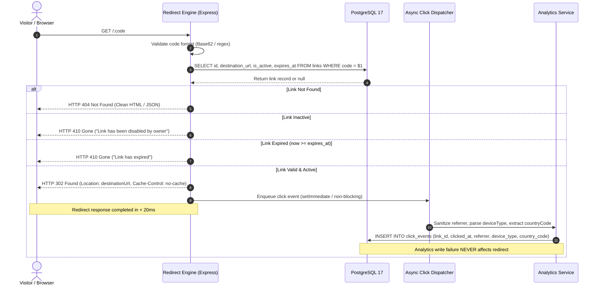
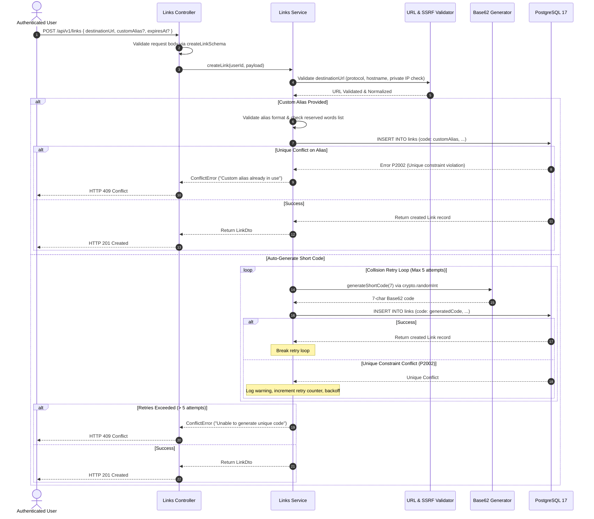

# URL Shortener — Comprehensive Engineering Implementation Plan & Architectural Blueprint

**Document Version:** 3.0  
**Author:** Senior Staff Software Engineer & System Architect (15+ Years Distributed Systems Experience)  
**Status:** Approved for Engineering Execution  
**Architecture:** Monorepo Modular Monolith (TypeScript, Express, Prisma, PostgreSQL 17, React, Vite, MUI)  
**Canonical Path:** `docs/implementation-plan.md`  
**Accompanying Task Breakdown:** `docs/tasks.md`  
**Development Rules & Invariants:** `AGENTS.md`

---

## 1. Executive Purpose, Architectural Vision & Core Invariants

### 1.1 Purpose
This document provides the exhaustive, production-grade implementation roadmap for the URL Shortener application. It is designed to guide an engineering team through the phased construction of a high-throughput, secure, multi-tenant link-management platform capable of serving millions of redirects with sub-50ms latency while maintaining rock-solid data integrity.

### 1.2 The 7 Non-Negotiable Engineering Invariants
All code, database operations, APIs, and client views must conform to these fundamental principles:

1. **PostgreSQL is the Authoritative Source of Truth:** Data integrity, uniqueness constraints (short codes, normalized user emails), foreign key relationships, and cascade behaviors are enforced at the database layer, not merely in application memory.
2. **Stateless, Ultra-Fast Redirect Engine:** The public redirect path (`GET /:code`) is strictly decoupled from the dashboard, rendering engines, and heavy analytics queries. Lookups are executed via unique indexes and return `HTTP 302 Found`. Caching headers prevent permanent browser caching.
3. **Decoupled Business Logic (Service-Repository Pattern):** Route handlers and Express controllers only parse HTTP input, validate headers, and format standard JSON envelopes. All business rules, transactions, Base62 code generation, and database interactions reside in dedicated service modules.
4. **Strict Ownership Boundary Enforcement:** Every authenticated mutation and analytics query must be explicitly scoped to the authenticated user ID (`WHERE id = $1 AND user_id = $authUserId`). Never trust client-supplied owner IDs.
5. **Zero SSRF & Safe Destination Policy:** Validate destination URLs server-side using standard URL parsers. Accept only `http:` and `https:`. Explicitly reject private IP subnets, loopback interfaces, and cloud metadata endpoints. Never fetch destination URLs server-side.
6. **Strict Forward-Compatible Migration Policy:** All database schema changes must use versioned, reviewed Prisma migrations (`prisma/migrations`). Destructive resets (`prisma migrate reset`) are strictly prohibited in shared and production environments.
7. **Privacy-Centric Analytics:** Never store raw IP addresses, raw User-Agent strings, or visitor fingerprints. Store only sanitized `deviceType` (desktop/mobile/tablet), stripped `referrer` domain, and ISO `countryCode`.

---

## 2. System Architecture & Component Interaction

### 2.1 Monorepo Topography
The repository is structured as a typed monorepo, decoupling client UI from the backend API while sharing data contracts, validation schemas, and configurations:

```text
url-shortener/
├── apps/
│   ├── web/                         # Frontend Application (React, Vite, TS, MUI)
│   └── api/                         # Backend API & Redirect Engine (Node.js, Express, Prisma)
├── packages/
│   ├── shared/                      # Shared Zod schemas, TypeScript types, constants
│   └── config/                      # Shared ESLint, Prettier, and TypeScript configs
├── docs/                            # Comprehensive specifications & tasks
├── docker-compose.yml               # Local PostgreSQL 17 development service
└── package.json                     # Monorepo root workspace definition
```

### 2.2 System Sequence Flows

#### Sequence 1: Public 302 Redirect & Decoupled Async Analytics Dispatch


#### Sequence 2: Link Creation & Bounded Collision Resolution


---

## 3. Detailed Phase-by-Phase Technical Engineering Roadmap

---

### Phase 0: Workspace Architecture, Tooling & Shared Contracts

#### 3.0.1 Macro Objectives
Establish monorepo scaffolding, compiler baselines, code quality pipelines, and the central data contract library (`packages/shared`).

#### 3.0.2 Technical Specifications & Implementation Blueprints
- **Monorepo Scaffolding:**
  - Setup root `package.json` with npm/pnpm workspaces: `["apps/*", "packages/*"]`.
  - Configure root scripts:
    ```json
    {
      "scripts": {
        "dev": "npm run dev --workspaces --if-present",
        "build": "npm run build --workspaces --if-present",
        "test": "npm run test --workspaces --if-present",
        "lint": "npm run lint --workspaces --if-present",
        "typecheck": "npm run typecheck --workspaces --if-present",
        "clean": "npm run clean --workspaces --if-present"
      }
    }
    ```
- **Shared Contracts (`packages/shared`):**
  - Concrete Zod schemas (`packages/shared/src/schemas`):
    ```typescript
    import { z } from 'zod';

    export const RESERVED_ALIASES = new Set([
      'api', 'admin', 'login', 'register', 'dashboard', 'health', 'ready',
      'metrics', 'favicon.ico', 's', 'static', 'assets', 'null', 'undefined'
    ]);

    export const destinationUrlSchema = z
      .string()
      .trim()
      .max(2048, 'URL must not exceed 2048 characters')
      .refine((val) => {
        try {
          const parsed = new URL(val);
          return parsed.protocol === 'http:' || parsed.protocol === 'https:';
        } catch {
          return false;
        }
      }, 'Destination URL must be a valid HTTP or HTTPS address');

    export const customAliasSchema = z
      .string()
      .trim()
      .min(3, 'Alias must be at least 3 characters')
      .max(32, 'Alias must not exceed 32 characters')
      .regex(/^[a-zA-Z0-9_-]+$/, 'Alias can only contain letters, numbers, hyphens, and underscores')
      .refine((val) => !RESERVED_ALIASES.has(val.toLowerCase()), 'This alias is reserved by the system');

    export const createLinkSchema = z.object({
      destinationUrl: destinationUrlSchema,
      customAlias: customAliasSchema.optional(),
      expiresAt: z.string().datetime({ offset: true }).optional().nullable()
        .refine((val) => !val || new Date(val) > new Date(), 'Expiration must be a future date'),
    });

    export const updateLinkSchema = z.object({
      destinationUrl: destinationUrlSchema.optional(),
      isActive: z.boolean().optional(),
      expiresAt: z.string().datetime({ offset: true }).optional().nullable()
        .refine((val) => !val || new Date(val) > new Date(), 'Expiration must be a future date'),
    });

    export const registerSchema = z.object({
      email: z.string().trim().email('Invalid email address').max(320),
      password: z.string()
        .min(8, 'Password must be at least 8 characters')
        .regex(/[A-Z]/, 'Password must contain at least one uppercase letter')
        .regex(/[a-z]/, 'Password must contain at least one lowercase letter')
        .regex(/[0-9]/, 'Password must contain at least one digit')
        .regex(/[^A-Za-z0-9]/, 'Password must contain at least one special symbol'),
    });

    export const loginSchema = z.object({
      email: z.string().trim().email('Invalid email address'),
      password: z.string().min(1, 'Password is required'),
    });
    ```

---

### Phase 1: Database Architecture & Data Access Foundation

#### 3.1.1 Macro Objectives
Deploy containerized PostgreSQL 17 locally, define canonical Prisma schemas, configure connection pooling, and execute database migrations.

#### 3.1.2 Database Sizing, Connection Pooling & Performance
- **Pool Sizing Formula:**  
  $$\text{Pool Size} = \min\left(\text{max\_connections} / \text{backend instances} - \text{headroom}, 20\right)$$
  For local development, pool size is set to 10. In production with Neon, Neon's serverless connection pooler (`pgbouncer`) handles connection concentration while direct connections (`DIRECT_URL`) are reserved exclusively for Prisma migrations.

#### 3.1.3 Canonical Prisma Schema (`apps/api/prisma/schema.prisma`)
```prisma
generator client {
  provider = "prisma-client-js"
}

datasource db {
  provider  = "postgresql"
  url       = env("DATABASE_URL")
  directUrl = env("DIRECT_URL")
}

enum UserRole {
  USER
  ADMIN
}

model User {
  id           String   @id @default(uuid()) @db.Uuid
  email        String   @unique @db.VarChar(320)
  passwordHash String   @map("password_hash") @db.VarChar(255)
  role         UserRole @default(USER)
  createdAt    DateTime @default(now()) @map("created_at") @db.Timestamptz(6)
  updatedAt    DateTime @updatedAt @map("updated_at") @db.Timestamptz(6)

  links Link[]

  @@map("users")
}

model Link {
  id             String    @id @default(uuid()) @db.Uuid
  userId         String    @map("user_id") @db.Uuid
  code           String    @unique @db.VarChar(32)
  destinationUrl String    @map("destination_url") @db.Text
  isActive       Boolean   @default(true) @map("is_active")
  expiresAt      DateTime? @map("expires_at") @db.Timestamptz(6)
  createdAt      DateTime  @default(now()) @map("created_at") @db.Timestamptz(6)
  updatedAt      DateTime  @updatedAt @map("updated_at") @db.Timestamptz(6)

  user        User         @relation(fields: [userId], references: [id], onDelete: Restrict)
  clickEvents ClickEvent[]

  @@index([userId, createdAt(sort: Desc)])
  @@index([expiresAt])
  @@map("links")
}

model ClickEvent {
  id          String   @id @default(uuid()) @db.Uuid
  linkId      String   @map("link_id") @db.Uuid
  clickedAt   DateTime @default(now()) @map("clicked_at") @db.Timestamptz(6)
  referrer    String?  @db.VarChar(512)
  deviceType  String?  @map("device_type") @db.VarChar(64)
  countryCode String?  @map("country_code") @db.VarChar(2)

  link Link @relation(fields: [linkId], references: [id], onDelete: Cascade)

  @@index([linkId, clickedAt(sort: Desc)])
  @@map("click_events")
}
```

---

### Phase 2: Backend Architecture & Core Middleware Engine

#### 3.2.1 Macro Objectives
Build the Express server with strict configuration validation, standardized error envelopes, structured JSON logging, and operational health probes.

#### 3.2.2 Centralized Error Envelope Specification
All exceptions are mapped to the standard envelope:
```typescript
export interface ApiErrorEnvelope {
  error: {
    code: string;
    message: string;
    details?: Array<{ field: string; message: string; code?: string }>;
    requestId?: string;
  };
}
```

#### 3.2.3 Error Handling Middleware Implementation
```typescript
import { Request, Response, NextFunction } from 'express';
import { ZodError } from 'zod';
import { AppError } from '../errors/app-error';
import { logger } from '../utils/logger';

export function errorHandler(
  err: Error,
  req: Request,
  res: Response,
  next: NextFunction
): void {
  const requestId = req.id || 'unknown';

  if (err instanceof ZodError) {
    const details = err.errors.map((e) => ({
      field: e.path.join('.'),
      message: e.message,
      code: e.code,
    }));

    res.status(400).json({
      error: {
        code: 'VALIDATION_ERROR',
        message: 'Invalid request payload',
        details,
        requestId,
      },
    });
    return;
  }

  if (err instanceof AppError) {
    res.status(err.statusCode).json({
      error: {
        code: err.errorCode,
        message: err.message,
        details: err.details,
        requestId,
      },
    });
    return;
  }

  // Unhandled internal errors
  logger.error({ err, requestId }, 'Unhandled application error');

  res.status(500).json({
    error: {
      code: 'INTERNAL_ERROR',
      message: process.env.NODE_ENV === 'production'
        ? 'An internal server error occurred'
        : err.message,
      requestId,
    },
  });
}
```

#### 3.2.4 Graceful Shutdown & Process Crash Resilience Blueprint
To prevent dropped connections, container crash loops, or zombie processes:
```typescript
import { Server } from 'http';
import { prisma } from '../database/db';
import { logger } from '../utils/logger';

let isShuttingDown = false;

export function setupGracefulShutdown(server: Server): void {
  async function shutdown(signal: string, error?: Error): Promise<void> {
    if (isShuttingDown) return;
    isShuttingDown = true;

    if (error) {
      logger.fatal({ signal, error }, 'Fatal error triggering emergency shutdown');
    } else {
      logger.info({ signal }, 'Termination signal received. Starting graceful shutdown');
    }

    // 1. Stop accepting new HTTP requests
    server.close(async () => {
      logger.info('HTTP server closed. Disconnecting database client pool...');
      try {
        await prisma.$disconnect();
        logger.info('Prisma disconnected cleanly. Process exiting.');
        process.exit(error ? 1 : 0);
      } catch (dbErr) {
        logger.error({ dbErr }, 'Error during database disconnection');
        process.exit(1);
      }
    });

    // 2. Safety fallback: Force termination if cleanup hangs past 10 seconds
    setTimeout(() => {
      logger.fatal('Graceful shutdown timed out after 10s. Forcefully terminating.');
      process.exit(1);
    }, 10000).unref();
  }

  process.on('SIGTERM', () => shutdown('SIGTERM'));
  process.on('SIGINT', () => shutdown('SIGINT'));
  process.on('uncaughtException', (err) => shutdown('uncaughtException', err));
  process.on('unhandledRejection', (reason) => shutdown('unhandledRejection', reason as Error));
}
```

---

### Phase 3: Authentication & Session Management Subsystem

#### 3.3.1 Macro Objectives
Implement cryptographic password hashing, constant-time verification, cookie-based session management, and brute-force mitigation.

#### 3.3.2 Argon2id Password Hashing Engine
```typescript
import * as argon2 from 'argon2';

export class PasswordService {
  public static async hashPassword(password: string): Promise<string> {
    return argon2.hash(password, {
      type: argon2.argon2id,
      memoryCost: 65536, // 64 MB
      timeCost: 3,       // 3 iterations
      parallelism: 4,    // 4 threads
    });
  }

  public static async verifyPassword(hash: string, plaintext: string): Promise<boolean> {
    try {
      return await argon2.verify(hash, plaintext);
    } catch {
      return false;
    }
  }
}
```

#### 3.3.3 Cookie Security & Subdomain Architecture Specification
For the production topology (`urlref.softics.in` frontend and `apiref.softics.in` backend):
- `domain: process.env.COOKIE_DOMAIN || '.softics.in'` — configured with `.softics.in` in production so modern browsers include the session cookie across all subdomains.
- `httpOnly: true` — completely inaccessible to document.cookie / XSS.
- `secure: process.env.NODE_ENV === 'production'` — transmitted only over TLS/HTTPS.
- `sameSite: 'lax'` — subdomains sharing the parent registrable domain (`softics.in`) are considered SameSite by browsers, protecting against third-party CSRF while transmitting on cross-subdomain fetch/navigation.
- `maxAge: 7 * 24 * 60 * 60 * 1000` — 7-day session validity.

---

### Phase 4: URL Management & Short-Code Generation Engine

#### 3.4.1 Macro Objectives
Implement unbiased Base62 short-code generation, robust SSRF destination verification, and link lifecycle management.

#### 3.4.2 Unbiased Base62 Code Generation
```typescript
import * as crypto from 'crypto';

const BASE62_ALPHABET = '0123456789abcdefghijklmnopqrstuvwxyzABCDEFGHIJKLMNOPQRSTUVWXYZ';
const ALPHABET_LENGTH = BASE62_ALPHABET.length; // 62

export function generateShortCode(length = 7): string {
  let result = '';
  // crypto.randomInt is uniformly distributed in [min, max) with zero modulo bias
  for (let i = 0; i < length; i++) {
    const randomIndex = crypto.randomInt(0, ALPHABET_LENGTH);
    result += BASE62_ALPHABET[randomIndex];
  }
  return result;
}
```

#### 3.4.3 Server-Side SSRF Prevention Engine
```typescript
import { ValidationError } from '../errors/app-error';

export function validateSafeDestinationUrl(rawUrl: string): string {
  let parsed: URL;
  try {
    parsed = new URL(rawUrl);
  } catch {
    throw new ValidationError('Invalid destination URL format');
  }

  if (parsed.protocol !== 'http:' && parsed.protocol !== 'https:') {
    throw new ValidationError('Only HTTP and HTTPS protocols are permitted');
  }

  const hostname = parsed.hostname.toLowerCase();

  // Reject local and private loopbacks
  if (
    hostname === 'localhost' ||
    hostname === '127.0.0.1' ||
    hostname === '0.0.0.0' ||
    hostname === '::1'
  ) {
    throw new ValidationError('Local and loopback destinations are prohibited');
  }

  // Reject RFC 1918 private subnets
  const ipv4Match = hostname.match(/^(\d{1,3})\.(\d{1,3})\.(\d{1,3})\.(\d{1,3})$/);
  if (ipv4Match) {
    const octet1 = parseInt(ipv4Match[1], 10);
    const octet2 = parseInt(ipv4Match[2], 10);

    if (
      octet1 === 10 || // 10.0.0.0/8
      (octet1 === 172 && octet2 >= 16 && octet2 <= 31) || // 172.16.0.0/12
      (octet1 === 192 && octet2 === 168) || // 192.168.0.0/16
      (octet1 === 169 && octet2 === 254) // 169.254.0.0/16 Cloud Metadata / Link-Local
    ) {
      throw new ValidationError('Private and internal network destinations are prohibited');
    }
  }

  return parsed.toString();
}
```

---

### Phase 5: High-Performance Public Redirect Engine

#### 3.5.1 Macro Objectives
Deliver a sub-20ms public redirect handler returning `HTTP 302 Found`, with asynchronous non-blocking click recording.

#### 3.5.2 Redirect Handler Implementation
```typescript
import { Request, Response, NextFunction } from 'express';
import { prisma } from '../../database/db';
import { dispatchClickEvent } from './click-dispatcher';

export async function handleRedirect(
  req: Request,
  res: Response,
  next: NextFunction
): Promise<void> {
  const { code } = req.params;

  try {
    const link = await prisma.link.findUnique({
      where: { code },
      select: {
        id: true,
        destinationUrl: true,
        isActive: true,
        expiresAt: true,
      },
    });

    if (!link) {
      res.status(404).json({ error: { code: 'LINK_NOT_FOUND', message: 'Short link not found' } });
      return;
    }

    if (!link.isActive) {
      res.status(410).json({ error: { code: 'LINK_INACTIVE', message: 'This link has been disabled' } });
      return;
    }

    if (link.expiresAt && new Date() >= link.expiresAt) {
      res.status(410).json({ error: { code: 'LINK_EXPIRED', message: 'This link has expired' } });
      return;
    }

    // Set HTTP 302 Found & disable permanent client caching
    res.set({
      'Location': link.destinationUrl,
      'Cache-Control': 'no-cache, no-store, must-revalidate',
      'Pragma': 'no-cache',
    });
    res.status(302).end();

    // Asynchronously dispatch click tracking without delaying HTTP response
    setImmediate(() => {
      dispatchClickEvent({
        linkId: link.id,
        rawReferrer: req.headers.referer || req.headers.referrer as string,
        userAgent: req.headers['user-agent'],
        countryCode: (req.headers['cf-ipcountry'] || req.headers['x-country-code']) as string,
      });
    });
  } catch (error) {
    next(error);
  }
}
```

---

### Phase 6: Privacy-Aware Analytics Subsystem

#### 3.6.1 Macro Objectives
Capture privacy-sanitized metrics and aggregate link and dashboard analytics via efficient PostgreSQL queries.

#### 3.6.2 Sanitizer Implementation
```typescript
export function sanitizeReferrer(rawReferrer?: string): string {
  if (!rawReferrer) return 'direct';
  try {
    const parsed = new URL(rawReferrer);
    return parsed.hostname.toLowerCase();
  } catch {
    return 'direct';
  }
}

export function classifyDeviceType(userAgent?: string): 'desktop' | 'mobile' | 'tablet' {
  if (!userAgent) return 'desktop';
  const ua = userAgent.toLowerCase();
  if (/(tablet|ipad|playbook|silk)|(android(?!.*mobi))/i.test(ua)) {
    return 'tablet';
  }
  if (/Mobile|iP(hone|od)|Android|BlackBerry|IEMobile|Kindle|NetFront|Silk-Accelerated|(hpw|web)OS|Fennec|Minimo|Opera M(obi|ini)|Blazer/i.test(ua)) {
    return 'mobile';
  }
  return 'desktop';
}

export function sanitizeCountryCode(code?: string): string | null {
  if (!code || typeof code !== 'string') return null;
  const cleaned = code.trim().toUpperCase();
  return /^[A-Z]{2}$/.test(cleaned) ? cleaned : null;
}
```

---

### Phase 7: Frontend Application & Interactive Dashboard

#### 3.7.1 Macro Objectives
Build a high-performance React + Vite + TypeScript + Material UI SPA featuring responsive navigation, instant link generation, data tables, and Recharts analytics.

#### 3.7.2 TanStack Query Cache Strategy
```typescript
export const queryKeys = {
  auth: { me: ['auth', 'me'] as const },
  links: {
    all: ['links'] as const,
    list: (filters: Record<string, unknown>) => ['links', 'list', filters] as const,
    detail: (id: string) => ['links', 'detail', id] as const,
    analytics: (id: string, range?: string) => ['links', 'analytics', id, range] as const,
  },
  analytics: {
    overview: (range?: string) => ['analytics', 'overview', range] as const,
  },
};
```

---

### Phase 8: Multi-Tier Verification & Quality Engineering

#### 3.8.1 Macro Objectives
Execute test suites across the test pyramid: Vitest (unit), Supertest (integration with PostgreSQL), and Playwright (end-to-end browser journeys).

#### 3.8.2 Testing Pyramid Distribution
- **Unit Tests (70%):** Short code generator, URL validation, Base62 distribution, expiration checks.
- **Integration Tests (20%):** Authentication, Link CRUD, 302 redirects, click tracking, cross-user isolation.
- **E2E Tests (10%):** Full user lifecycle journeys using headless Chromium/WebKit/Firefox.

---

### Phase 9: Cloud Deployment, Security Hardening & Observability

#### 3.9.1 Macro Objectives
Deploy containerized backend on Render, static frontend on Vercel, managed PostgreSQL on Neon, edge routing on Cloudflare, and error monitoring via Sentry.

#### 3.9.2 Production Multi-Stage Dockerfile (`apps/api/Dockerfile`)
```dockerfile
# Stage 1: Build & Compile
FROM node:20-alpine AS builder
WORKDIR /app
COPY package*.json ./
COPY packages/ ./packages/
COPY apps/api/ ./apps/api/
RUN npm ci
RUN npm run build -w packages/shared
RUN npx prisma generate --schema=apps/api/prisma/schema.prisma
RUN npm run build -w apps/api

# Stage 2: Production Runner
FROM node:20-alpine AS runner
WORKDIR /app
ENV NODE_ENV=production
COPY package*.json ./
COPY packages/shared/package*.json ./packages/shared/
COPY packages/shared/dist ./packages/shared/dist
COPY apps/api/package*.json ./apps/api/
COPY apps/api/prisma ./apps/api/prisma
RUN npm ci --omit=dev
COPY --from=builder /app/apps/api/dist ./apps/api/dist
USER node
EXPOSE 5000
CMD ["node", "apps/api/dist/server.js"]
```

---

## 4. Disaster Recovery & Operational Runbooks

### 4.1 Disaster Recovery Objectives
- **Recovery Point Objective (RPO):** < 1 hour (automated Neon point-in-time recovery).
- **Recovery Time Objective (RTO):** < 15 minutes (stateless backend recovery).

### 4.2 Expand-and-Contract Migration Runbook
For future breaking schema changes:
1. **Expand:** Add new column/table as nullable in Prisma schema; deploy migration.
2. **Dual-Write:** Deploy backend version writing to both old and new schema.
3. **Backfill:** Execute asynchronous data migration script.
4. **Contract:** Update application reads to use new schema; drop obsolete column in a subsequent release.

---

## 5. Milestone Schedule & Verification Gates

```text
Week 1: Foundations & Persistence (Tasks 001 - 006)
Week 2: Backend Architecture & Auth (Tasks 007 - 016)
Week 3: URL Engine & Public Redirects (Tasks 017 - 023)
Week 4: Analytics Engine & Frontend Foundation (Tasks 024 - 031)
Week 5: Links Management UI & Multi-Tier Testing (Tasks 032 - 037)
Week 6: Production Hardening, CI/CD & Launch (Tasks 038 - 042)
```

Refer to [`docs/tasks.md`](file:///c:/Users/Abhijeet%20Rawat/Desktop/urlref/docs/tasks.md) for the active task tracker and execution status.
