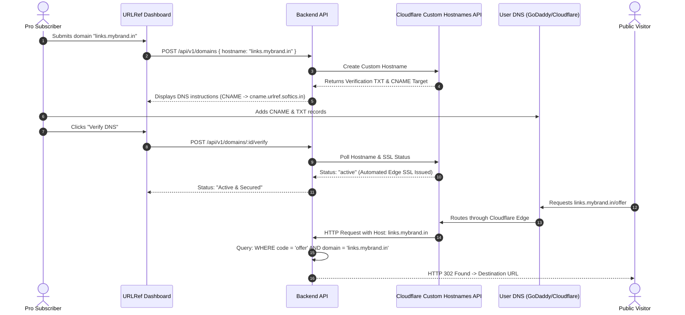

# Product Requirements Document (PRD)

## Production URL Shortener & Dynamic QR Platform (URLRef)

**Document status:** Approved for Commercial Development  
**Version:** 2.0  
**Product:** URLRef (Enterprise Link Shortener & Branded QR Studio)  
**Platform:** Web application (`urlref.softics.in` / `apiref.softics.in`)  
**Primary Market:** India (D2C Brands, Creators, E-Commerce, Digital Agencies, SMBs)  
**Monetization Engine:** Razorpay Subscriptions & UPI AutoPay (₹199/mo or ₹1,999/yr Pro Tier)  

---

## 1. Product Overview & Commercial Vision

**URLRef** is an enterprise-grade link management and dynamic QR generation platform engineered specifically for the Indian market. It bridges the gap between high-speed 302 redirection, custom branded domains (BYOD), and a zero-compute client-side QR studio that supports high-utility Indian channels (including UPI payment QRs and WhatsApp direct chats).

The product transforms standard commodity links into branded, trackable marketing assets (`go.brand.in/summer-sale`), protecting user privacy with zero raw IP logging while delivering actionable click and scan metrics.

---

## 2. Market Opportunity & Target Audience

### 2.1 The Indian SaaS Market Gap
Existing global players (Bitly, Rebrandly) charge in USD ($13 to $35/month, or ₹1,100 to ₹2,900/month), which creates massive billing friction (RBI e-mandate credit card blocks) and price resistance for Indian small businesses. 

URLRef captures this market by pricing in INR (₹199/month or ₹1,999/year upfront) with native **UPI AutoPay and NetBanking support via Razorpay**, tailored specifically for:
* **D2C & E-Commerce Brands:** Need branded vanity links on SMS and WhatsApp marketing campaigns to improve CTR by up to 34%.
* **Instagram & WhatsApp Sellers:** Need branded WhatsApp chat links and custom UPI payment QR codes for offline table tents and packaging.
* **Marketing & Event Agencies:** Need dynamic QR codes that can be printed on 10,000 brochures and edited later without reprinting costs.

---

## 3. Product Pricing Matrix & Unit Economics

To protect gross margins, prevent server cost bleed, and incentivize annual cash-flow collection, the product enforces three tiers:

| Feature / Quota | Free Community (₹0) | Pro Creator (₹199 / mo or ₹1,999 / yr) | Growth Agency (₹499 / mo or ₹4,999 / yr) |
|---|---|---|---|
| **Short Links Quota** | 10 links / calendar month | **100 links / calendar month** | **1,000 links / calendar month** |
| **Custom Branded Domains** | ❌ **0** (Strictly `urlref.softics.in`) | **1 Custom Domain** (`go.brand.in`) | **3 to 5 Custom Domains** |
| **Dynamic QR Codes** | ❌ Static preview only | **100 Dynamic QRs** (Editable post-print) | **Unlimited Dynamic QRs** |
| **QR Code Styling** | Standard B&W (PNG only) | **Branded Colors + Center Logo + PNG** | **High-Res PNG + Lossless Vector SVG** |
| **Supported Channels** | Web URL only | URL, WhatsApp, UPI, SMS, Email, Phone | All Channels + WiFi + vCard |
| **Analytics Retention** | 7 days aggregate | **30 days detailed** | **1 year + CSV Data Export** |
| **White-Labeling** | Default Softics branding | Custom 404 destination | Custom 404 + Custom OpenGraph Preview |
| **Payment Gateway** | N/A | **Razorpay** (UPI AutoPay, Cards, NetBanking) | **Razorpay** (GST Invoicing) |

> **Accounting Rule:** Custom domains (`go.mybrand.in`) are strictly gated to paid plans. Giving away custom domains on a free tier destroys monetization leverage and inflates DNS/support costs.

---

## 4. Core Feature Specifications

### 4.1 Feature 1: Advanced Client-Side QR Studio

A dedicated interactive studio available on the landing page and dashboard that allows users to create branded, scannable QR codes for multiple channels without consuming server CPU resources.

#### Supported Channels & Encoding Rules
1. **Website URL:** `https://destination.com`
2. **WhatsApp Direct:** Formats phone number and pre-filled message into `https://wa.me/<countryCode><phone>?text=<encodedMessage>`.
3. **UPI Payment QR (India Native):** Formats standard NPCI UPI intent: `upi://pay?pa=<vpa>&pn=<name>&am=<amount>&cu=INR`.
4. **Phone / Call:** `tel:<phoneNumber>`.
5. **SMS Intent:** `sms:<phoneNumber>?body=<encodedMessage>`.
6. **Email:** `mailto:<email>?subject=<encodedSubject>&body=<encodedBody>`.
7. **WiFi Auto-Connect:** `WIFI:S:<SSID>;T:<WPA|WEP|nopass>;P:<password>;;`.

#### Customization & Safe Rendering Engine
* **Rendering Architecture:** HTML5 `<canvas>` and native `<svg>` generation client-side using `qrcode`.
* **Color Customization:** Foreground (dark) and Background (light) color pickers with contrast ratio checking.
* **Center Logo Embedding:**
  * User can upload custom logo image (PNG/JPG, up to 2MB).
  * Automatically draws a circular/rounded backdrop pill behind the logo.
  * Constrains logo footprint to a maximum of 20% of canvas area.
  * Programmatically forces **Error Correction Level `H` (30% error recovery)** whenever custom logos or colors are active.
* **Export Formats:**
  * Standard/High-Res PNG (256px, 512px, 1024px).
  * Lossless Vector SVG (for commercial print shops, billboards, product labels).
* **Dynamic vs. Static Mode:**
  * **Static Mode:** Encodes the raw destination string directly into the QR.
  * **Dynamic Mode (Pro Feature):** Encodes an underlying URLRef short link. When the user changes their marketing campaign, they can update the destination URL in the dashboard without reprinting the physical QR.

---

### 4.2 Feature 2: Custom Branded Domains (BYOD) via Cloudflare for SaaS

Allows paid customers to connect their own custom subdomains (e.g. `links.mybrand.in` or `go.store.com`) to route short links.

#### Architecture & Ingress Flow

#### Domain Verification Safeguards
* **TXT Ownership Challenge:** Prevents subdomain hijacking by requiring `_urlref-verify.<subdomain>` verification.
* **Multi-Tenant Scoping:** Link lookups must match `code` AND verified `domain` to ensure complete tenant isolation.

---

### 4.3 Feature 3: Rebrandly-Style Lead Capture Modal

To drive top-of-funnel customer acquisition, unauthenticated visitors on the landing page receive **1 free short link / QR generation**.

#### Acquisition Mechanics
1. **First Action:** Guest creates a link/QR; system saves it to `localStorage` (`urlref_guest_link`) and presents the download/copy controls.
2. **Second Action Trigger:** When the guest clicks *"Create another QR code"* or *"Shorten another URL"*, the application suppresses generation and displays the **Lead-Capture Modal**:
   * **Headline:** *"Need more QR codes & Short links?"*
   * **Value Proposition:** *"Sign up for free now to unlock 10 free links/month, QR management, and click tracking."*
   * **Loss Aversion Hook:** *"Your existing shortened link and QR code will automatically be imported into your new account."*
   * **Primary CTA:** *"Sign Up Free"* (redirects to `/register`).
3. **Auto-Claiming Engine:** Upon registration or login, [`AuthContext`](file:///c:/Users/Abhijeet%20Rawat/Desktop/urlref/apps/web/src/context/AuthContext.tsx) calls `POST /api/v1/links/claim` with the stored guest link ID, binding it to the new account.

---

### 4.4 Feature 4: Razorpay Indian Payment Gateway Integration

1. **Payment Methods:** UPI AutoPay (Google Pay, PhonePe, Paytm), Domestic Credit/Debit Cards, NetBanking.
2. **Subscription Lifecycle:**
   * Recurring monthly mandate via Razorpay Subscriptions.
   * 1-click Annual Plan checkout (₹1,999/yr) to bypass monthly card failure friction.
3. **Webhook Processing (`/api/v1/billing/razorpay-webhook`):**
   * Handles `subscription.charged`, `payment.captured`, `subscription.cancelled`, `subscription.halted`.
   * Enforces HMAC-SHA256 signature verification on all webhook payloads.
   * Updates user subscription status and generates GST-compliant downloadable invoice receipts.

---

## 5. Non-Functional & Security Requirements

1. **Stateless 302 Redirection:** Redirect engine must maintain p95 latency under 50ms, executing indexed lookups without blocking on analytics or external APIs.
2. **Safe Destination URLs & SSRF Prevention:** Destination URLs must be parsed via native WHATWG `URL`. Accept only `http:` and `https:`. Do not fetch destination content server-side.
3. **Privacy Sanitization:** Click events must strictly sanitize visitors (desktop/mobile/tablet, referrer domain, ISO country code). Never persist raw IP addresses or fingerprint hashes.
4. **Crash Prevention & Connection Pooling:** Singleton Prisma client using PgBouncer/Neon connection poolers (`?connection_limit=10&pool_timeout=5`).
5. **ReDoS & Payload Defense:** Limit all URL inputs to 2,048 characters.

---

## 6. Phased Implementation Roadmap

* **Phase 1 (Immediate):**
  * Advanced Client-Side QR Studio (URL, WhatsApp, UPI, Email, Phone, WiFi) with custom colors and center logo overlay.
  * Rebrandly-Style Lead Capture Modal for unauthenticated second-action triggers.
* **Phase 2 (Cloudflare for SaaS & Custom Domains):**
  * Prisma schema migration for `CustomDomain` model.
  * Cloudflare Custom Hostnames integration and DNS verification status wizard.
  * Host-aware public redirect router.
* **Phase 3 (Monetization & Razorpay):**
  * Razorpay Checkout modal for ₹199/mo and ₹1,999/yr plans.
  * Webhook listener and subscription quota management.
